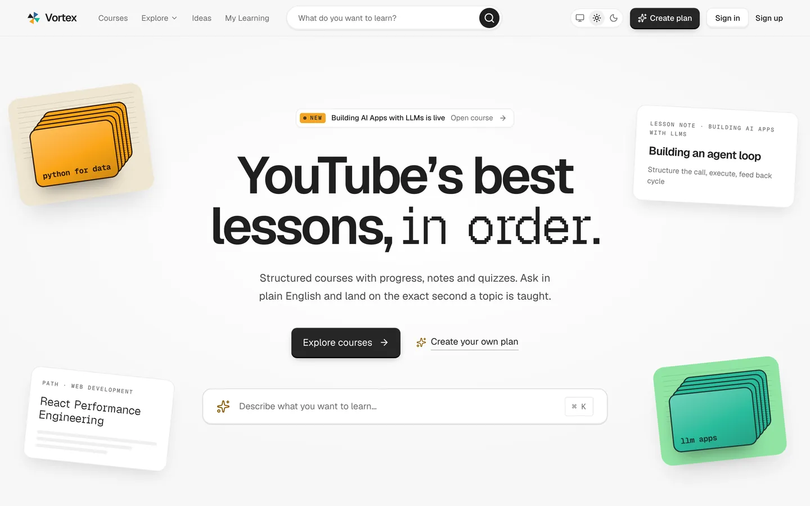
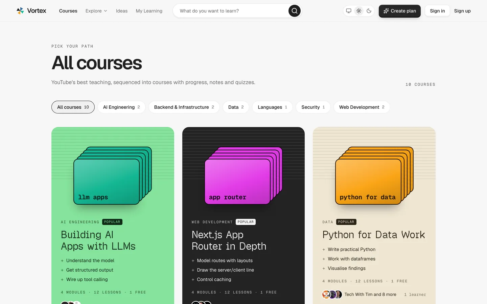
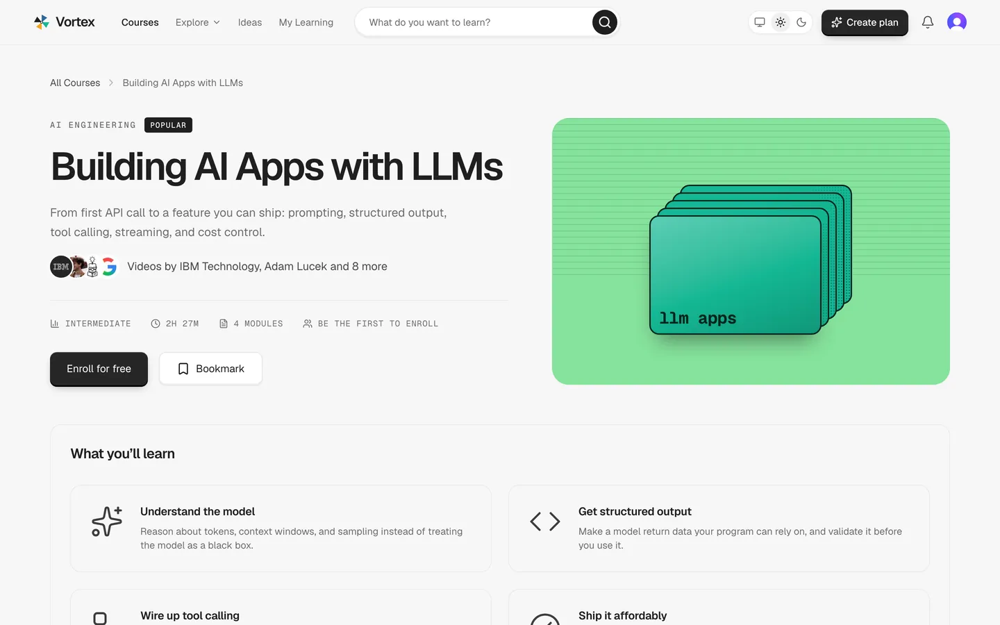
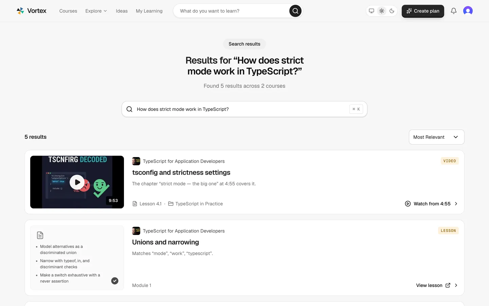
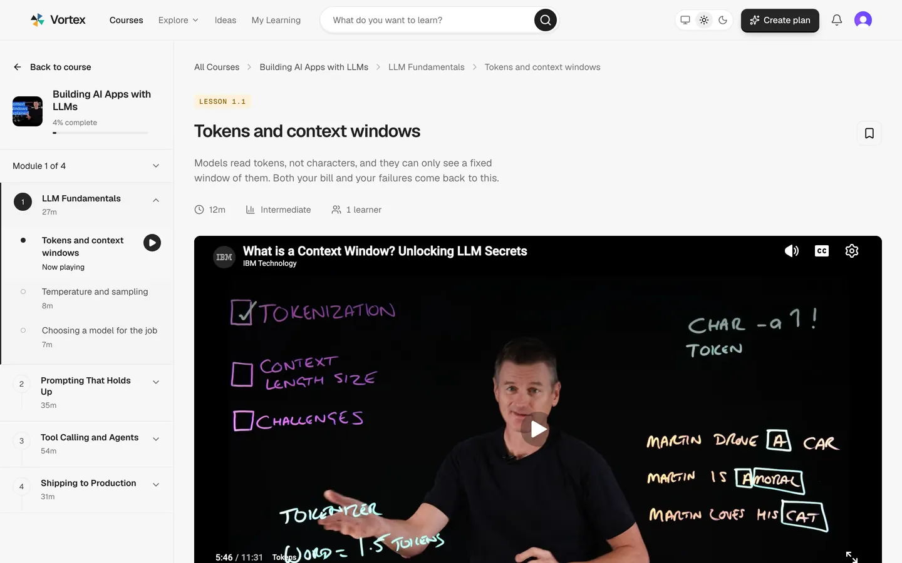
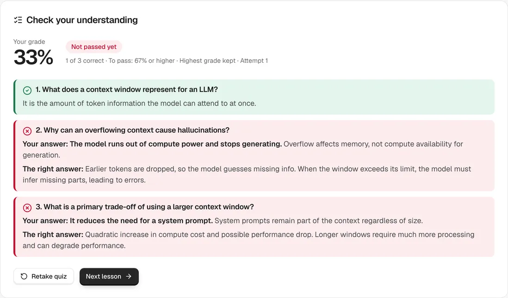
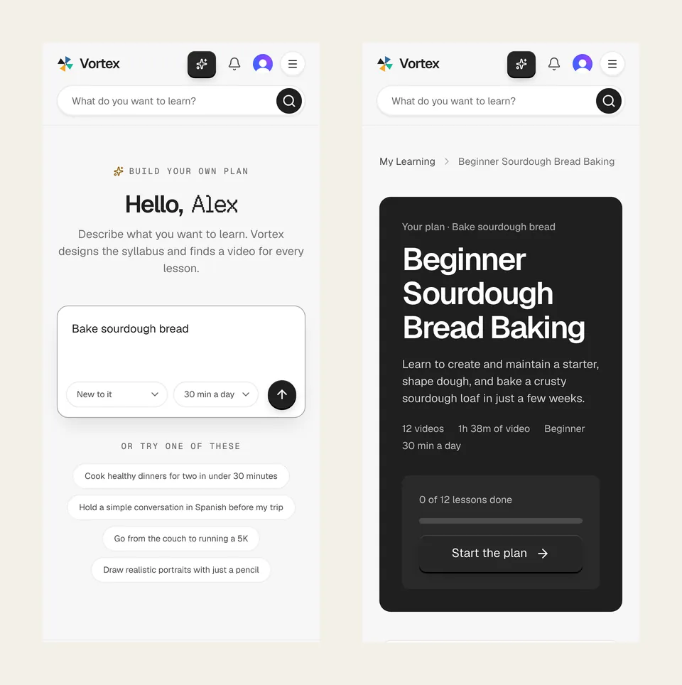

<div align="center">
  <br />
  
  <br />

  <div>
    
    
    <br/>
    
    
    
    
  </div>

  <h3 align="center">Vortex | YouTube's best lessons, in order</h3>

  <p align="center"><a href="https://vortex-seven-self.vercel.app">vortex-seven-self.vercel.app</a></p>
</div>

## Table of Contents

1. [What Vortex is](#what-vortex-is)
2. [Screenshots](#screenshots)
3. [Features](#features)
4. [How it works](#how-it-works)
5. [Repository layout](#repository-layout)
6. [Tech stack](#tech-stack)
7. [Quick start](#quick-start)
8. [Environment variables](#environment-variables)
9. [Scripts](#scripts)

## What Vortex is

Vortex turns YouTube videos into real courses. Each course is a sequence of modules and lessons built from videos by the creators who made them, with notes, saved progress and a short quiz after every lesson.

Search takes a plain-English question and returns the lessons that teach it, linked to the exact second in the video where the topic comes up. For anything that isn't a course yet, a learner can describe a goal, and Vortex designs a personal syllabus and finds a YouTube video for every lesson.

The catalog holds 10 courses in 8 categories: 120 lessons, each backed by a video document with its chapters and transcript.

## Screenshots

| Catalog | Course |
| --- | --- |
|  |  |
| **Search** | **Lesson** |
|  |  |
| **Quiz** | **Personal plan** |
|  |  |

## Features

- **Courses in order.** Each course has modules of lessons in a deliberate sequence. Every video is credited to its creator, and the course page shows who made the videos.
- **Search by question.** Ask in plain English and get ranked result cards of two kinds:
  - **Video results** start the lesson's player at the matched second.
  - **Lesson results** match a lesson on its topic.

  Results show a count and a sort control, and every card is built from real data.
- **Lessons that play on the site.** Videos play in the provider's own embed on the lesson page, next to the notes, key points, resources and the course outline.
- **Saved progress.** Your place in every video saves to the second, and lessons are marked complete as you watch. Courses, lessons and My Learning all offer to resume where you left off.
- **A quiz after every video.** Three questions with feedback on every option. Submit to see your grade and what you missed, then retake it until you pass. Your highest grade is kept.
- **Personal plans.** Describe a goal, your level and the time you have each day, and Vortex designs a syllabus and picks a YouTube video for every lesson.
  - Plans are private and track their own progress.
  - Each plan lesson gets a quiz written from that video's captions.
  - Up to 5 plans a day per learner.
- **My Learning.** Your enrolled courses and plans, with progress.
- **Ideas board.** Suggest a course or a feature and vote on what gets built next. Posting and voting need an account.
- **Field notes and the roadmap.** Short articles from instructors, and a map of every category's courses and modules.
- **About.** A 90-second film about Vortex, with captions, and four looping clips that show how it works.

## How it works

The repo holds two separate workspaces: the Next.js app at the root and the Sanity Studio in `studio/`. They deploy independently.

**Content.**
- Authors write courses, lessons, categories and posts in Sanity Studio.
- The dataset is private, so the app reads it server-side with a read token.
- Courses embed modules, and modules reference lessons. A lesson finds its course through a reverse reference.
- Lesson notes are Portable Text.

**Video documents.**
- An offline pipeline (`studio/scripts/ingest`) builds one `video` document per video URL.
- Each holds the video's chapter markers and its transcript, split into short timestamped chunks.
- Lessons link to their video by URL. These documents are an internal lookup for search and quizzes and are never shown as results.

**Search** (`app/api/search`, `lib/search`) runs on the server:
1. It connects to the Sanity Context MCP, which scopes what the model can see through the `sanity.agentContext` document.
2. It gives the model the schema and a system prompt. The model writes GROQ queries: chapters first, then transcript chunks, then lesson topics.
3. A keyword pass runs alongside, and the two result sets are merged.
4. Every hit is grounded. Each card's title, labels, thumbnail, duration and timestamp are read back from Sanity, so the model cannot invent any of them.

Search runs on Groq (open-weight gpt-oss) by default. Set `SEARCH_PROVIDER=openai` to switch to OpenAI.

**Plans** (`app/api/plans`, `lib/plans`):
- A Groq model designs the syllabus.
- The YouTube Data API finds candidate videos for each lesson, with safe search on and embeddable videos only, and the model picks the best match per lesson.
- Plans are stored per learner, with a daily quota.
- A plan lesson's quiz is written from its video's captions the first time it is opened, then cached.

**Accounts and writes.**
- Clerk handles sign-in. `proxy.ts` protects My Learning, plans, and the progress, enroll, plans and ideas APIs. Browsing stays public.
- Progress, enrollments, plans and votes are keyed to the Clerk user id. They are written only by server routes, using a write token that never reaches the browser.

**Analytics.**
- PostHog runs in the browser with the public project key: catalog and course views, lesson views and completions, video plays and watch depth.
- Search events are captured on the server, in the route that runs the search.

## Repository layout

```
app/                    Next.js App Router pages and API routes
  api/search            search: Context MCP + LLM, then grounding
  api/plans             personal plans and their quizzes and progress
  api/progress, enroll  learner progress and enrollment writes
  api/ideas             the Ideas board (posts and votes)
  courses, lessons      catalog, course and lesson pages
  plans, my-learning    plans and the learner's dashboard
  search, about, blog, ideas, roadmap, tools
components/             UI by area (course, lesson, search, plans, ...)
lib/                    search, plans, progress, quiz, ideas, analytics, formatting
sanity/                 the app's server-only Sanity clients (read and write) and GROQ queries
proxy.ts                Clerk middleware: which routes need a session
studio/                 Sanity Studio: schema, desk structure, and offline scripts
  schemaTypes/          course, lesson, video, category, post, quiz, plan, progress, idea, ...
  scripts/seed          the catalog seed
  scripts/ingest        chapters and transcript chunks for video documents
  scripts/quiz          offline quiz generation, grounded in transcripts
  scripts/context       the search agent's Context document
  scripts/explainer     the About film (Remotion), its voice, score and mix
prompts/                implementation notes for each piece of work
```

## Tech stack

- **[Next.js 16](https://nextjs.org/)** (App Router) and **React 19**, in **TypeScript**.
- **[Tailwind CSS](https://tailwindcss.com/) v4**, with the design tokens in `app/globals.css`. Geist and Geist Mono are the typefaces.
- **[Sanity](https://www.sanity.io/)**: Studio, `next-sanity`, `@sanity/image-url`, `@portabletext/react`, and the **Sanity Context MCP** for search.
- **[Vercel AI SDK](https://ai-sdk.dev/)** with **[Groq](https://groq.com/)** (gpt-oss) through its OpenAI-compatible API. **OpenAI** is optional for search.
- **[YouTube Data API v3](https://developers.google.com/youtube/v3)** for plans.
- **[Clerk](https://clerk.com/)** for authentication.
- **[PostHog](https://posthog.com/)** for product analytics.
- **[Zod](https://zod.dev/)** to validate model output and request bodies.
- **[Remotion](https://www.remotion.dev/)** for the About film, which is not part of the app build.

## Quick start

**Prerequisites:** Node.js 20+, npm, and accounts for Sanity, Clerk and Groq. A YouTube Data API key is needed for plans.

```bash
git clone https://github.com/Eternal128/vortex.git
cd vortex
npm install
cp .env.example .env.local   # then fill it in (see below)
npm run dev                  # http://localhost:3000
```

The Studio is its own workspace:

```bash
cd studio
npm install
npm run dev                  # http://localhost:3333
```

The Context MCP only serves a dataset that has a deployed Studio, so run `npm run deploy` in `studio/` once before search will work.

## Environment variables

`.env.example` is the full list. Everything is server-only unless it starts with `NEXT_PUBLIC_`.

| Variable | Used for |
| --- | --- |
| `NEXT_PUBLIC_SANITY_PROJECT_ID`, `NEXT_PUBLIC_SANITY_DATASET` | The Sanity project and dataset |
| `SANITY_API_READ_TOKEN` | Reading the private dataset (Viewer token) |
| `SANITY_API_WRITE_TOKEN` | Learner writes: progress, enrollments, plans, ideas (Editor token) |
| `SANITY_CONTEXT_MCP_URL` | The search agent's Sanity Context MCP endpoint |
| `NEXT_PUBLIC_CLERK_PUBLISHABLE_KEY`, `CLERK_SECRET_KEY` | Clerk sign-in |
| `NEXT_PUBLIC_CLERK_SIGN_IN_URL`, `NEXT_PUBLIC_CLERK_SIGN_UP_URL` and the two fallback redirects | Clerk routes |
| `GROQ_API_KEY` | Search (by default), plans and offline quiz generation |
| `YOUTUBE_API_KEY` | Finding videos for plans |
| `OPENAI_API_KEY` | Search, only when `SEARCH_PROVIDER=openai` |
| `SEARCH_PROVIDER`, `SEARCH_MODEL` | Optional: choose the search provider, or pin one model |

PostHog's project key is public by design and is the only analytics key the browser sees.

## Scripts

**App** (repo root):

| Command | What it does |
| --- | --- |
| `npm run dev` | Development server |
| `npm run build`, `npm start` | Production build and server |
| `npm run lint`, `npm run typecheck` | ESLint and `tsc --noEmit` |

**Studio** (`studio/`):

| Command | What it does |
| --- | --- |
| `npm run dev`, `npm run deploy` | Run or deploy the Studio |
| `npm run typegen` | Extract the schema and generate types |
| `npm run seed:build`, `npm run seed:import` | Build and import the catalog |
| `npm run ingest:videos`, `ingest:build`, `ingest:import` | Fetch chapters and transcripts, and import the video documents |
| `npm run quiz:generate`, `quiz:import` | Generate quizzes from transcripts, and import them |
| `npm run context:import` | Import the search agent's Context document |

The About film is rendered separately from `studio/scripts/explainer/motion`; see `render.mjs` there.

**Publishing content to the live site**

Content queries are cached until Sanity says something changed, and on Vercel that cache survives
redeploys. Add a webhook once so published and imported content shows straight away:

1. Generate a secret (`openssl rand -hex 32`) and set it as `SANITY_REVALIDATE_SECRET` in Vercel
   (Production), then redeploy.
2. In [sanity.io/manage](https://sanity.io/manage) → your project → **API** → **Webhooks** → **Create
   webhook**:
   - URL: `https://<your-domain>/api/revalidate`, dataset `production`, HTTP method `POST`
   - Trigger on: Create, Update, Delete
   - Filter: `_type in ["post", "course", "lesson", "category"]`
   - Projection: `{_type}`
   - Secret: the same value as `SANITY_REVALIDATE_SECRET`

Content that was cached before the webhook existed needs one purge: Vercel → **Settings** →
**Caches** → purge the Data Cache.

---

_Originally started from a [JavaScript Mastery](https://www.youtube.com/@javascriptmastery) tutorial; rebuilt and maintained here as Vortex._
